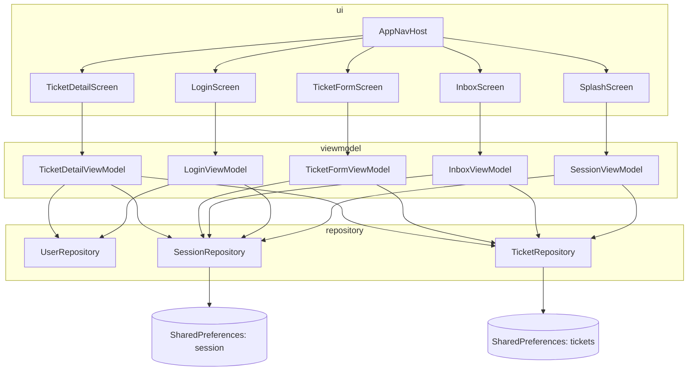
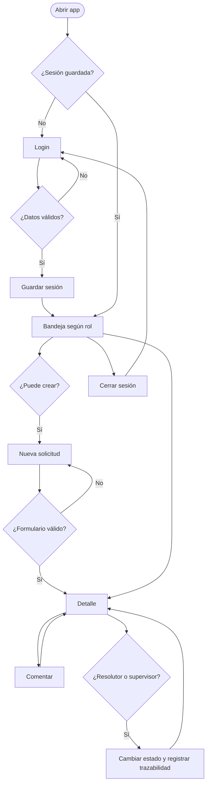

# PanalSuite Mobile

MVP académico Android para la gestión móvil de flujos de trabajo de PanalSuite (DSY1105 · Desarrollo de Aplicaciones Móviles · Duoc UC). Usa solo datos ficticios.

## Stack

- Kotlin + Jetpack Compose + Material 3
- Arquitectura MVVM
- Navigation Compose
- Almacenamiento local con SharedPreferences (solicitudes, comentarios y sesión)

## Funcionalidades

- Login validado con sesión persistente
- Bandeja según rol: el solicitante ve sus solicitudes, el resolutor las asignadas y el supervisor todas, con indicadores por estado
- Filtros por estado
- Formulario de nueva solicitud con validaciones
- Detalle con cambio de estado (solo resolutor y supervisor), comentarios y trazabilidad de cada cambio
- Animaciones: splash, transiciones entre pantallas, listas, avisos y botones
- Tema claro y oscuro

## Usuarios de prueba

Contraseña para todos: `Panal123`

| Rol         | Correo                 |
|-------------|------------------------|
| Solicitante | solicitante@panal.test |
| Resolutor   | resolutor@panal.test   |
| Supervisor  | supervisor@panal.test  |

## Diagrama de arquitectura



## Diagrama de flujo



## Estructura

```
app/src/main/java/com/duoc/panalsuite/
├── MainActivity.kt
├── model/          ← qué es cada dato
├── repository/     ← de dónde salen los datos
├── viewmodel/      ← el estado y las decisiones
└── ui/             ← lo que se dibuja
    ├── navigation/
    └── theme/
```

## Ejecutar

1. Clonar el repositorio y abrirlo en Android Studio.
2. Sincronizar Gradle.
3. Ejecutar en un emulador o dispositivo con Android 7.0 (API 24) o superior.

## Autora

Macarena del Pilar Leighton Ortiz · Duoc UC